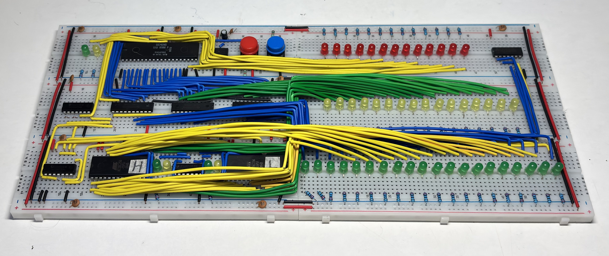
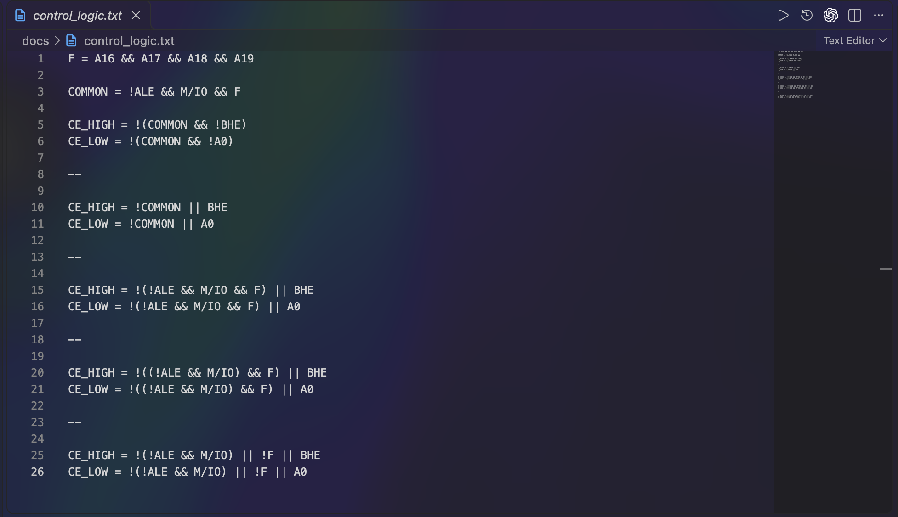
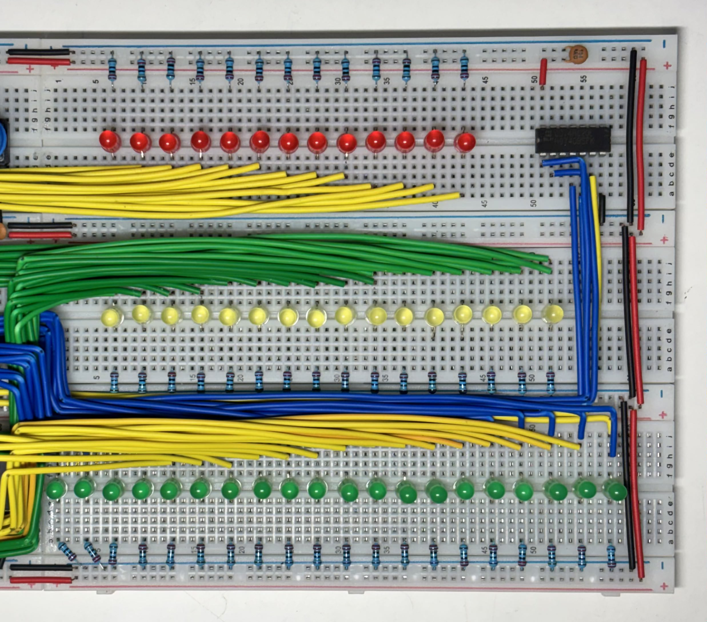
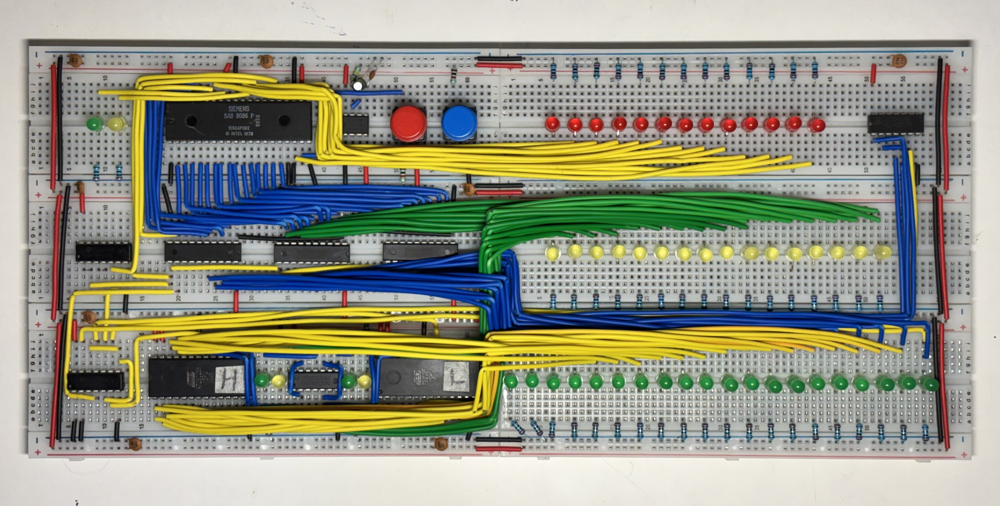
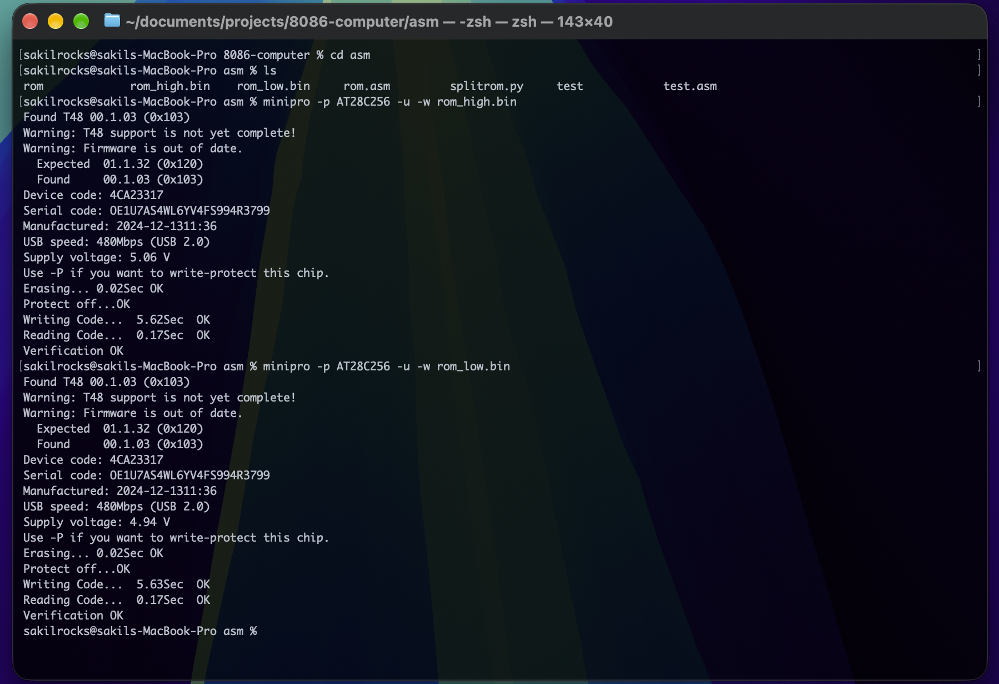
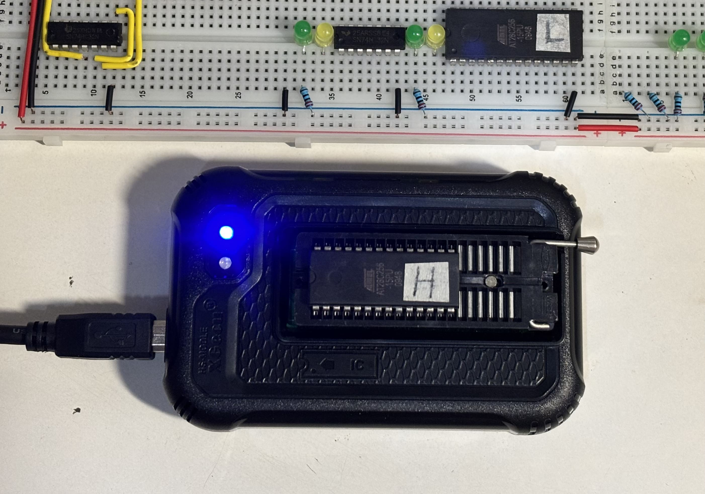
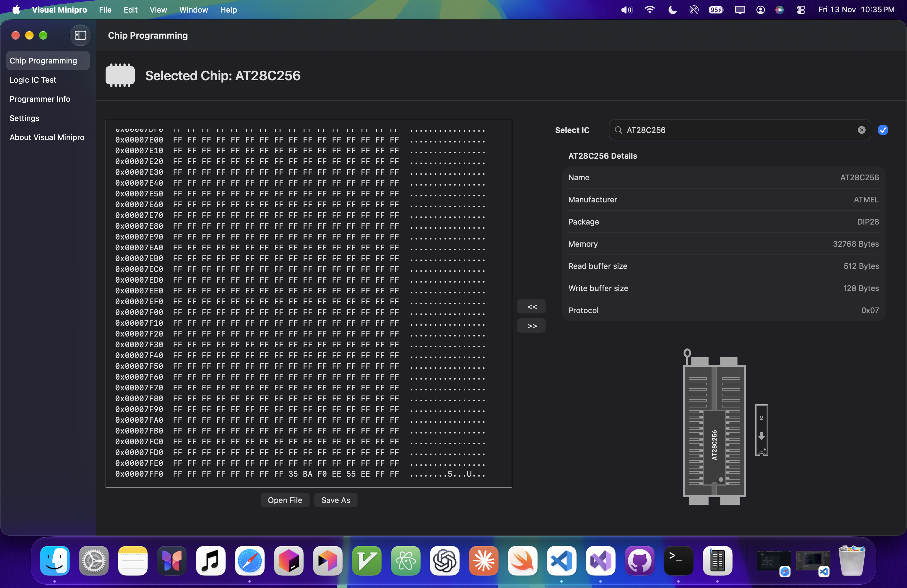

# 8086-computer

A breadboard implementation of the Intel 8086 microprocessor, built from discrete logic and memory components. The project brings together clock
generation, reset circuitry, address latching, ROM interfacing, and LED based signal monitoring to build and understand a working 8086 based
computer.



---

## Overview

The system is built around the Intel 8086 microprocessor, with external latches, EEPROMs, clock and reset circuitry, and LED indicators for
monitoring processor activity.

The 8086 uses a multiplexed address/data bus, which requires external latches to capture the address before the bus is used for data transfer.
Two AT28C256 EEPROMs provide the program memory, while the LED indicators expose the processor’s address, data, and control signals, making it
easier to observe what happens during execution.

---

## Project Structure

```
8086-computer/
  ├── bin/
  ├── asm/
  ├── docs/
  ├── .gitignore
  ├── LICENSE
  └── README.md
```

---

## How It Works

### 1. Intel 8086 Microprocessor

The Intel 8086 is the central processing unit of the system. It executes instructions fetched from external ROM and communicates with the memory
through its multiplexed address/data bus.

### 2. Clock and Reset Circuitry

The system includes a 555 timer circuit for clock generation and two push buttons for manual control.

* Red button: Reset switch, used to reset the processor.
* Blue button: Manual clock pulse input, used to step the processor through clock cycles.

### 3. Address Latches

Three 74HC573 octal transparent latches are used to capture and hold address and associated signals from the multiplexed bus.

These latches are important because the 8086 shares address and data lines. The address must be captured before those lines are reused for data
transfers.

### 4. Memory Control Logic



The system includes custom control logic to decode memory addresses and generate the chip-enable signals for the two AT28C256 EEPROMs.

The logic monitors the upper address lines (A16–A19) to identify the Fxxxx memory address range. It then combines this address decoding with the
processor’s memory-cycle signals, including ALE and M/IO, to determine when the EEPROMs should be enabled.

The high-byte and low-byte EEPROMs are selected independently using the 8086’s /BHE and A0 signals:

* High-byte EEPROM: Selected using /BHE.
* Low-byte EEPROM: Selected using A0.

The resulting CE_HIGH and CE_LOW signals are active-low chip-enable signals that control which EEPROM responds to a memory access.

### 5. LED Monitoring System



One of the main features of this build is the LED monitoring system. It provides a visual representation of the processor’s signals while it
operates.

The indicators are divided into three groups:

**Red LEDs – CPU Control and Status Signals**

These indicators expose the following processor signals:

```
DEBUG  /BHE  /RD  /HLDA  /WR  M/IO  DT/R  /DEN  ALE  INTR  /INTA  RESET  CLOCK
```

**Yellow LEDs – Data Bus**

A set of 16 yellow LEDs displays the data bus bits, allowing the data being transferred by the processor to be observed.

**Green LEDs – Address Bus**

The green LEDs display the address bus bits, providing a visual representation of the memory addresses accessed by the processor.

---

## Gallery

### Hardware Assembly



A closer look at the processor, memory chips, latches, and supporting circuitry.

### EEPROM Programming



Programming the EEPROMs with the ROM contents using command-line tools.

### T48 Universal Programmer



The T48 programmer used to write the program onto the AT28C256 EEPROM chips.

### ROM Contents




Verifying the programmed ROM contents using XGecu Visual Minipro.

---

## Why I Built This

I wanted to understand how a microprocessor works beyond its internal architecture and instruction set. Building this computer gave me an
opportunity to work directly with the 8086’s hardware interface, understand its multiplexed address and data bus, explore memory interfacing, and
observe processor signals in real time. Rather than relying on an emulator or development board, I wanted to put together the actual hardware and
see how the different components interact.
